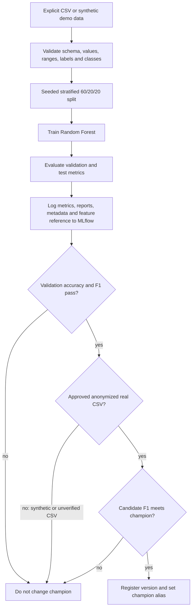
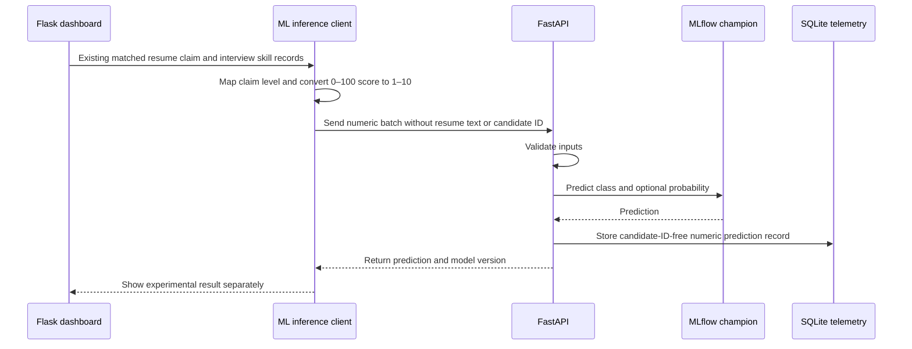

# HireWise AI

HireWise AI is a mock interview and career preparation platform for engineering students. It combines a Flask web application with speech and AI services, resume analysis, adaptive interview features, and a separately deployable MLOps service.

The Random Forest service is an **optional experimental integration**. The Flask dashboard can still operate when the FastAPI service is unavailable. This repository has not been fully verified end to end or deployed; see [Verification status and limitations](#verification-status-and-limitations).

## Contents

- [Features](#features)
- [Architecture](#architecture)
- [Student workflow](#student-workflow)
- [Technology](#technology)
- [Application structure](#application-structure)
- [AI, speech, and assessment](#ai-speech-and-assessment)
- [MLOps model and data](#mlops-model-and-data)
- [Flask and FastAPI integration](#flask-and-fastapi-integration)
- [Monitoring and retraining](#monitoring-and-retraining)
- [Configuration](#configuration)
- [Local setup](#local-setup)
- [MLOps local workflow](#mlops-local-workflow)
- [Tests and CI](#tests-and-ci)
- [Deployment configuration](#deployment-configuration)
- [Verification status and limitations](#verification-status-and-limitations)
- [Privacy and responsible use](#privacy-and-responsible-use)

## Features

### Interview preparation

- HR, technical, mixed, company-specific, and resume-based interview practice.
- Question selection from the project's question bank and AI-generated follow-up questions.
- Recorded audio/video responses and speech transcription.
- Answer scoring and feedback, with local fallback behavior when external AI is unavailable.
- Adaptive question selection and per-skill estimates stored with interview sessions.
- Speaking pace and filler-word summaries.
- Video-based eye-contact, head-stability, and attention analysis when the optional computer-vision libraries are available.
- Dashboard, interview history, feedback reports, resume workflows, and mentor chat.

When OpenCV or MediaPipe is unavailable, the CV service returns generated fallback scores. Those values are not measurements from the candidate's video.

### Resume and skill analysis

- PDF text extraction and heuristic/AI-assisted extraction of skills, projects, and related resume information.
- The existing rule-based Resume Inflation Score in the adaptive interview analysis.
- A separate experimental Random Forest comparison of numeric claimed-skill and measured-ability inputs. The dashboard displays this separately and does not replace the rule-based score.

### MLOps service

- Explicit CSV ingestion with schema, missing-value, duplicate, numeric-range, label, and class-count checks.
- Seeded synthetic data for development and testing.
- Stratified train, validation, and test splits; Random Forest training and evaluation.
- MLflow experiment tracking, model registration, and quality-gated champion promotion.
- FastAPI health, single prediction, batch prediction, and monitoring endpoints.
- Candidate-ID-free numeric prediction telemetry and PSI-based feature drift reporting.
- Manually triggered retraining. Prediction logs and drift reports do not trigger training automatically.

## Architecture

The Flask application handles user accounts, interviews, resumes, and dashboards. The MLOps model service runs separately and can be deployed independently.

```mermaid
flowchart LR
  Student[Student browser] --> Flask[Flask app and templates]
  Flask --> Routes[Flask routes]
  Routes --> Services[Application services]
  Services --> DB[(SQLite or configured PostgreSQL)]
  Services --> AI[Groq / optional Claude and speech services]
  Routes --> Dashboard[Dashboard]
  Dashboard --> Client[ML inference client]
  Client -->|numeric batch only| API[FastAPI model service]
  API --> Champion[MLflow champion model]
  API --> Telemetry[(SQLite prediction telemetry)]
  API --> Monitoring[/monitoring]

  CSV[Explicit CSV or synthetic demo data] --> Validate[Data validation]
  Validate --> Train[Random Forest training]
  Train --> Evaluate[Metrics and quality gate]
  Evaluate -->|pass| Eligible{Approved anonymized real CSV?}
  Eligible -->|yes| Registry[MLflow model registry]
  Eligible -->|no: synthetic or unverified CSV| EvalOnly[Evaluation only; keep current champion]
  Evaluate -->|fail| Keep[Keep current champion]
  Registry --> Champion
  CI[GitHub Actions] -. checks and container build .-> API
```

### Training pipeline



### Prediction flow



## Student workflow

1. A student registers or signs in.
2. The student selects an interview type and answers questions.
3. The application transcribes speech when speech input is used and evaluates the answer through configured AI/fallback logic.
4. Interview results and skill-state data are stored in the application database.
5. The adaptive engine uses the current estimates to help select questions.
6. The dashboard presents scores, history, and improvement areas.
7. When a completed interview includes matched resume claim and assessment data, the dashboard can request an optional experimental ML comparison.

## Technology

| Area | Technologies used in the repository |
|---|---|
| Web backend | Python, Flask, Flask-Login, Flask-SQLAlchemy |
| Frontend | Jinja templates, HTML, CSS, JavaScript, Chart.js |
| Database | SQLAlchemy; SQLite by default or configured PostgreSQL |
| AI services | Groq integration; optional Claude-compatible service path and local fallback logic |
| Speech | Groq Whisper API, SpeechRecognition Google API fallback, browser transcript fallback |
| Computer vision | Optional OpenCV and MediaPipe; generated fallback scores if unavailable |
| MLOps | pandas, NumPy, scikit-learn, MLflow |
| Model serving | FastAPI and Uvicorn |
| Packaging and CI | Docker and GitHub Actions |

The main runtime is declared as Python 3.11.9 in `runtime.txt`. The MLOps Docker image uses Python 3.12. Dependency files are the source of truth for package versions. The root requirements do not include OpenCV or MediaPipe; those paths are optional.

## Application structure

```text
app.py                         Flask application factory and local entry point
config.py                      Environment, database, and upload configuration
database/connection.py         SQLAlchemy initialization, seeding, and SQLite backup logic
models/                        SQLAlchemy entities for users, interviews, responses, etc.
routes/                        Auth, interview, resume, mentor, dashboard, and admin routes
services/                      AI, speech, resume, CV, adaptive, email, and ML client logic
datasets/questions.json        Question bank loaded by database initialization
templates/                     Jinja application and email templates
static/                         CSS, JavaScript, and research images
migrations/                    Alembic configuration and migration revisions
scripts/                        Research export and SQLite-to-Supabase utility scripts
mlops/data.py                  CSV/synthetic loading and training-data validation
mlops/train.py                 Training, evaluation, MLflow logging, and promotion gate
mlops/serve.py                 FastAPI inference and monitoring endpoints
mlops/prediction_store.py      SQLite prediction telemetry and PSI monitoring
mlops/tests/                   MLOps data, API, integration, and monitoring tests
mlops/Dockerfile               Non-root FastAPI container
mlops/render.yaml              Separate ML service deployment configuration
.github/workflows/ci.yaml      Validation and non-publishing Docker build workflow
render.yaml                    Flask deployment configuration
Procfile                       Gunicorn command for the Flask application
requirements.txt               Main application dependencies
mlops/requirements.txt         MLOps service and test dependencies
```

## AI, speech, and assessment

### AI services

The application has Groq service code for interview-related language tasks and a mentor path that can use Groq, optional Claude, or local fallback responses. Configure `GROQ_API_KEY` to use Groq; keys are managed through the [Groq Console](https://console.groq.com/). The Random Forest is a different component: it accepts structured numeric features and does not process natural-language resumes or answers.

### Speech transcription

The `WhisperService` tries Groq's Whisper API, then SpeechRecognition's Google API, then a browser-provided transcript. The root requirements include SpeechRecognition; the application does not load a local OpenAI Whisper model in this path. Transcription produces text; answer scoring happens separately.

### Adaptive skill assessment

`services/adaptive_engine.py` updates skill estimates and uncertainty from interview responses, chooses subsequent questions, and builds a competency map. The dashboard also contains a synthetic Decision Tree helper, but the current readiness display uses its rule-based fallback because that classifier is not loaded into the prediction path.

### Rule-based score and experimental model

The existing rule-based Resume Inflation Score compares extracted resume claim levels with estimated interview skill levels. The Random Forest uses numeric `claimed_skill`, `measured_ability`, and their difference. Its output is experimental and is not proof that a person has been dishonest or inflated a resume.

## MLOps model and data

### Dataset and validation

`mlops/train.py` uses generated demo data by default. It does not read the application database. A supplied CSV must contain exactly:

| Column | Requirement |
|---|---|
| `claimed_skill` | Numeric value from 1 to 10 |
| `measured_ability` | Numeric value from 1 to 10 |
| `difference` | `claimed_skill - measured_ability` |
| `inflated` | Integer target label, 0 or 1 |

The loader rejects missing or unexpected columns, missing/non-numeric values, duplicate rows, out-of-range scores, inconsistent differences, invalid target labels, and class counts below the minimum. CSV provenance defaults to `provided_csv_unverified_provenance`. `--dataset-label approved_anonymized_real` is an operator attestation; it does not verify consent, anonymization, or data quality beyond the schema checks.

The synthetic generator creates 1,000 examples by default. Labels come from a threshold rule on `difference` with seeded label flips. Metrics on this generated task do **not** demonstrate real-world candidate assessment quality.

### Training, evaluation, and MLflow

Training uses seeded, stratified 60/20/20 train/validation/test splits and a Random Forest. It records accuracy, precision, recall, F1, confusion matrix, classification report, dataset metadata, and a feature-only reference CSV in MLflow. The default promotion gate requires validation accuracy and F1 of at least 0.80; a candidate must also meet or exceed the champion's validation F1. A candidate that fails the gate does not change the champion alias. Synthetic demo data and CSVs labeled `provided_csv_unverified_provenance` are evaluation-only and can never promote a model. Only a supplied CSV explicitly labeled `approved_anonymized_real` is eligible; the label is an operator attestation, not automated provenance verification.

The registry model name is `hirewise-inflation-detector`; serving loads its `champion` alias. A new champion is picked up after a service restart. MLflow tracking, registration, artifact access, and model loading have not been verified in this environment.

## Flask and FastAPI integration

`services/ml_inference_service.py` reads `HIREWISE_ML_SERVICE_URL`, `HIREWISE_ML_TIMEOUT_SECONDS`, and `HIREWISE_ML_API_KEY`. It sends the key in the `X-API-Key` header and uses skill claim categories already present in the interview competency map to send one numeric batch per dashboard request:

- Claimed level mapping: Beginner = 3, Intermediate = 6, Advanced = 8, Expert = 10.
- Interview score mapping: `1 + 9 * score / 100`.

These mappings are explicit proxies for the model scale and need calibration. The request contains numeric values only, not resume text or a candidate identifier. FastAPI validates the request and response; the dashboard degrades gracefully if there is no matched skill pair or the service is unavailable. The rule-based score remains separate.

The model service endpoints are:

- `GET /health` is an unauthenticated liveness check returning only `{"status":"ok"}`.
- `POST /predict`, `POST /predict/batch` (1–50 pairs), and `GET /monitoring` require `X-API-Key` matching `HIREWISE_ML_API_KEY`.
- Missing or incorrect client credentials return HTTP 401. If the service key is unset or blank, protected endpoints fail closed with HTTP 503.

Generate a high-entropy key, then set the same value for the Flask application and FastAPI service. For example, run `python -c "import secrets; print(secrets.token_urlsafe(32))"` and store the result in local environment files or the hosting provider's secret settings. Never commit the generated value. `/health` intentionally reveals no model or monitoring state.

The API does not implement request-rate limiting. Before public exposure, terminate HTTPS at an API gateway, reverse proxy, or WAF and enforce these ingress limits: at most 60 combined `/predict` and `/predict/batch` requests per source IP per minute, at most 10 `/monitoring` requests per source IP per minute, bursts no larger than 10, and a 1 MiB request body limit. Preserve `X-API-Key` when forwarding. The batch cap limits items per request but not request frequency. A hosting blueprint alone does not configure these controls.

## Monitoring and retraining

Prediction records are stored separately from the application database in SQLite. They contain a random request ID, timestamp, model name/version, numeric features, predicted class, optional probability, and request status. They do not include candidate identity or raw resume/interview content. A telemetry write failure does not invalidate an otherwise successful prediction.

Prediction telemetry is stored in SQLite and is not automatically deleted. Its default retention is indefinite; deleting old records requires the explicit cleanup command below. The records contain numeric assessment values and may still be sensitive even though no candidate ID or raw content is stored. Set an access and retention policy before using real candidate data.

The monitoring API reports all-time count summaries and compares feature distributions using PSI. By default `MLOPS_MONITORING_WINDOW_DAYS=30` limits PSI to valid telemetry from the most recent 30 days; set it to `0` to compare all retained rows. A per-feature PSI >= 0.20 is reported as potential data drift. PSI is a warning signal, not a diagnosis or a measure of model accuracy. Concept drift is not detected because ground-truth outcomes are not collected or compared. At least two valid rows per feature are needed to calculate PSI.

Cleanup is manual and defaults to preview mode:

```powershell
python -m mlops.cleanup_telemetry --older-than-days 180
python -m mlops.cleanup_telemetry --older-than-days 180 --apply
```

The first command reports how many rows match without deleting them. Only the second command deletes matching rows.

Retraining is manual. Synthetic data and unverified CSVs are evaluation-only and cannot update the champion, even if they pass metric gates. A supplied CSV labeled `approved_anonymized_real` is eligible for promotion after validation and champion comparison; the label is an operator attestation. Prediction telemetry is not automatically used for training, and drift does not automatically trigger retraining.

## Configuration

| Variable | Default/example | Used by |
|---|---|---|
| `FLASK_SECRET_KEY` | Set a private local value | Flask session and signed tokens |
| `FLASK_ENV` | `production` in `.env.example` | Flask configuration |
| `DATABASE_URL` | `sqlite:///database/hirewise.db` in `.env.example`; SQLite fallback if unset | Main application database |
| `GROQ_API_KEY` | Empty/placeholder in `.env.example` | Groq AI and Whisper paths |
| `GROQ_WHISPER_MODEL` | `whisper-large-v3` in `.env.example` | Groq transcription |
| `WHISPER_MODEL_NAME` | `tiny` in `.env.example` | Whisper service configuration |
| `SUPABASE_URL`, `SUPABASE_KEY` / `SUPABASE_ANON_KEY` | Optional | Supabase auth/OAuth paths |
| `CLAUDE_API_KEY` / `ANTHROPIC_API_KEY` | Optional | Claude mentor fallback |
| `HIREWISE_ML_SERVICE_URL` | `http://127.0.0.1:8000` | Flask ML client |
| `HIREWISE_ML_TIMEOUT_SECONDS` | `2` | Flask ML client timeout |
| `HIREWISE_ML_API_KEY` | Set the same private key in Flask and FastAPI environments | API authentication |
| `MLFLOW_TRACKING_URI` | `http://127.0.0.1:6001` | MLOps trainer and serving process |
| `MLOPS_PREDICTION_DB` | `mlops/data/predictions.db` | FastAPI prediction telemetry |
| `MLOPS_MONITORING_WINDOW_DAYS` | `30`; `0` means all retained rows | PSI monitoring window |

Other optional email settings are read by `config.py` (`MAIL_SERVER`, `MAIL_PORT`, `MAIL_USERNAME`, `MAIL_PASSWORD`, and `MAIL_USE_TLS`). See `.env.example` and `config.py` for the values actually read by the application. Do not commit real credentials.

## Local setup

Run commands from the repository root. Application startup initializes the database, creates tables, performs some automatic schema adjustments, seeds records, and may create SQLite backups. Start against a local/disposable database first; do not point this setup at production data without reviewing those startup behaviors.

### Windows PowerShell

```powershell
python -m venv .venv
.\.venv\Scripts\Activate.ps1
pip install -r requirements.txt
Copy-Item .env.example .env
python app.py
```

Set private credentials and configuration values in `.env` as needed. Open `http://localhost:5000` after the server starts. The app can run without the optional ML service; its experimental model comparison will be unavailable.

For macOS/Linux, activate the environment with `source .venv/bin/activate`. The root `Procfile` uses `gunicorn app:app`; `render.yaml` contains Flask deployment configuration, but deployment has not been verified.

`verify_setup.py` imports and initializes the Flask app and checks the database. It is not a read-only diagnostic; use it only with a local/disposable database.

## MLOps local workflow

Install `mlops/requirements.txt` in the environment used for training and the model service. A local MLflow server is required for the documented tracking/registry flow. Run each command in a separate terminal where indicated.

1. Start MLflow from the repository root:

   ```powershell
   mlflow server --backend-store-uri sqlite:///mlflow.db --host 127.0.0.1 --port 6001
   ```

2. Train synthetic demo data, or pass a reviewed CSV:

   ```powershell
   python -m mlops.train
   python -m mlops.train --dataset path/to/approved.csv --dataset-label approved_anonymized_real
   ```

   The default synthetic run is evaluation-only and never promotes a champion. A CSV is also evaluation-only unless explicitly labeled `approved_anonymized_real`; that label is an operator attestation.

3. Start FastAPI:

   ```powershell
   Copy-Item mlops/.env.example mlops/.env
   # Set the same HIREWISE_ML_API_KEY in .env and mlops/.env
   uvicorn mlops.serve:app --env-file mlops/.env --host 127.0.0.1 --port 8000
   ```

   The root `.env` configures Flask, and `mlops/.env` configures FastAPI without passing unrelated application secrets to the model service. Both must use the same generated `HIREWISE_ML_API_KEY`. The MLOps requirements include `python-dotenv` for Uvicorn's `--env-file` support.

4. In another terminal, run the Flask app using [Local setup](#local-setup).

5. Run MLOps tests:

   ```powershell
   python -m pytest -q mlops/tests
   ```

The training and MLflow commands above describe the configured workflow; end-to-end model tracking/registry behavior was not verified in the recorded local checks. The Docker service can be built locally with `docker build -t hirewise-mlops:local ./mlops` when Docker is available. See [mlops/README.md](mlops/README.md) for the CSV schema, API details, Docker run command, and monitoring information.

## Tests and CI

`.github/workflows/ci.yaml` runs on pushes and pull requests targeting `main`. It installs the root and MLOps requirements, checks Python syntax, imports the Flask app with disposable database/upload paths, runs the MLOps tests, runs `pip-audit` on MLOps requirements, and builds the Docker image. The workflow does not publish images, deploy, or run MLflow model promotion.

The FastAPI `TestClient` suite may stall in some Windows environments. See the audit results below for the checks actually run here. YAML parsing is not a substitute for running the GitHub workflow.

## Deployment configuration

- `Procfile` and root `render.yaml` describe the Flask/Gunicorn service.
- `mlops/render.yaml` describes a separate FastAPI Docker service with persistent prediction storage configuration.
- `mlops/Dockerfile` uses a non-root user and health check; `.dockerignore` excludes environment files and local artifacts.
- GitHub Actions builds the MLOps image for validation but does not publish it.

These files are configuration only. Neither service has been deployed or validated in a hosting environment.

## Verification status and limitations

The following reflects checks run during the current local audit; environment limitations and failures are listed explicitly.

| Check | Recorded result |
|---|---|
| Focused data, promotion, telemetry, cleanup, PSI-window, Flask-client, and API-key policy tests | 16 passed; the in-process Flask-to-FastAPI HTTP test was deselected for this focused run |
| Full MLOps suite | 32 tests collected; execution stalled at the first Starlette `TestClient` health request on Windows and was interrupted after about 55 seconds |
| FastAPI endpoint and in-process HTTP integration tests | Not verified: the `TestClient` harness stalled before returning a response; endpoint authentication tests are present but could not complete here |
| Python compilation | Passed with `python -m compileall -q app.py config.py routes services mlops` |
| Render and CI YAML parsing | Passed with PyYAML |
| Flask application startup | Not run: Flask is not installed in the current Python environment |
| MLflow tracking, registration, and live model loading | Not run: MLflow is not installed and no tracking server is available; synthetic promotion policy was tested with a fake client |
| Docker build | Not run: Docker CLI is present but the Docker daemon is unavailable |
| Dependency audit | Not run: `pip-audit` is not installed |
| Root test collection | Could not complete: existing `test_groq.py` exits during collection when `GROQ_API_KEY` is absent; no root suite tests ran |
| Hosting deployment | Not run; no deployment is claimed |

Metrics from synthetic runs describe only a generated threshold-label task with seeded noise; they do not show real-world resume assessment quality. This audit did not run a live MLflow training or promotion flow.

Other limitations:

- The resume claim category and interview score mappings are proxies that need calibration.
- PSI is a basic univariate drift signal; it does not establish a drop in model quality.
- Concept drift is unavailable without ground-truth labels.
- Prediction telemetry defaults to SQLite, is retained indefinitely unless an operator explicitly runs cleanup, and requires access controls and a retention policy for real candidate data.
- Prediction and monitoring endpoints require a shared API key. The service has no built-in rate limiter; use a rate-limiting gateway, reverse proxy, or WAF before public exposure.
- MLflow connectivity, model registry behavior, and live model loading need end-to-end verification.
- The readiness Decision Tree helper in `routes/dashboard.py` is not currently loaded by the dashboard path.
- Deployment configuration does not mean that a service was deployed.

## Privacy and responsible use

- Training never reads the application database. Only explicitly supplied CSVs or synthetic demo data are used.
- Do not include names, contact information, raw resume text, audio/video, or other personal information in training CSVs.
- The `approved_anonymized_real` label is an operator attestation, not an automated consent or anonymization check.
- The inference client sends numeric skill values only; prediction telemetry does not store candidate IDs or raw content.
- Keep secrets out of source control and configure access/retention before production use.
- Treat the Random Forest as an experimental signal, not a hiring decision or proof of dishonesty. Use appropriate human review.
