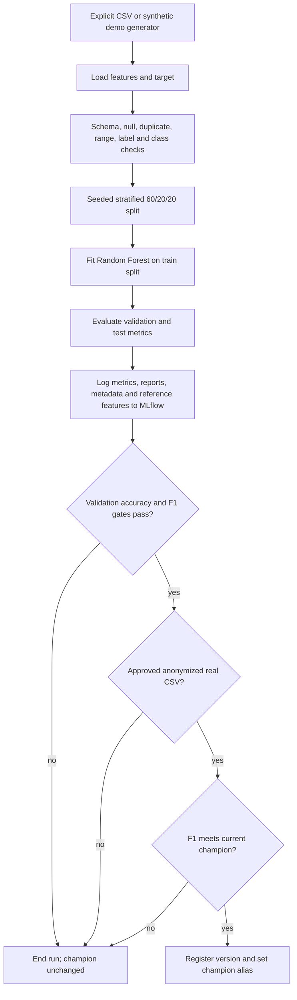
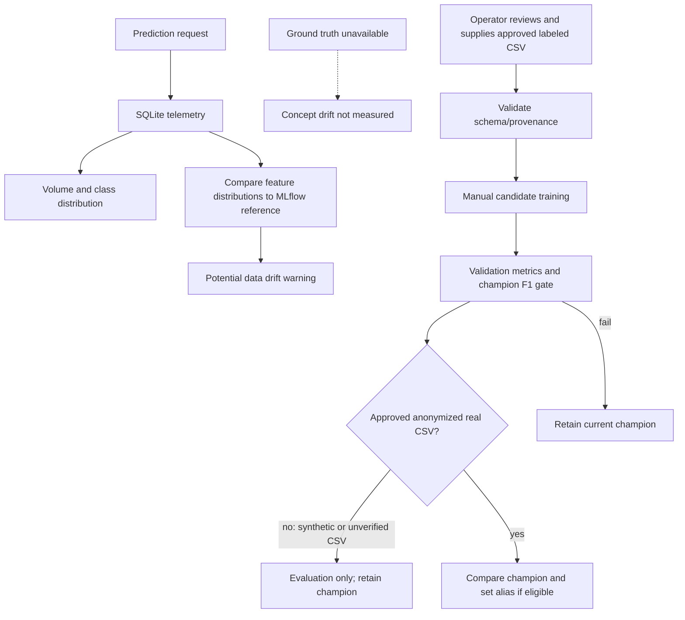
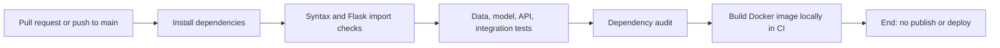

# HireWise MLOps service

This module is a separately deployable experimental resume skill inflation classifier. The Flask app calls it optionally from the dashboard using numeric claim and interview assessment values already present in the completed interview competency map. If the service is unavailable, the dashboard keeps displaying its existing rule-based score.

The model is trained on generated synthetic examples by default. Those examples and any resulting metrics are for development demonstrations; they do not show real-world accuracy. The app never exports database records into training data.

## Architecture

```mermaid
flowchart LR
  User[Candidate dashboard] --> Flask[Flask app]
  Flask -->|numeric scores only; timeout protected| API[FastAPI /predict]
  API --> Registry[MLflow champion model]
  API --> Store[(SQLite prediction telemetry)]
  API --> Monitor[/monitoring report]
  CSV[Explicitly supplied CSV] --> Validate[Schema and quality validation]
  Demo[Seeded synthetic generator] --> Validate
  Validate --> Split[Stratified train / validation / test]
  Split --> Train[Random Forest]
  Train --> Evaluate[Metrics, report, confusion matrix]
  Evaluate --> Gate{Validation quality passes?}
  Gate -->|pass| Eligibility{Approved anonymized real CSV?}
  Eligibility -->|yes| Registry
  Eligibility -->|no: synthetic or unverified CSV| EvalOnly[Evaluation only; keep current champion]
  Gate -->|fail| Keep[Keep current champion]
```

## Training pipeline



## Prediction and inference pipeline

```mermaid
sequenceDiagram
  participant D as Flask dashboard
  participant C as ML client service
  participant A as FastAPI
  participant M as Champion model
  participant S as SQLite telemetry
  D->>C: Matched claim levels and interview skill scores
  C->>C: Map claim category and scale 0–100 score to 1–10
  C->>A: POST numeric batch; no resume text or candidate ID
  A->>A: Validate input schema and ranges
  A->>M: Predict class and optional probability
  M-->>A: Prediction
  A->>S: Save numeric features, model version and status
  A-->>C: Predictions plus request IDs and model version
  C-->>D: Separate experimental ML comparison
```

## Dataset schema and privacy

Training CSVs have exactly these columns:

| Column | Type/range | Meaning |
|---|---|---|
| `claimed_skill` | number, 1–10 | Resume claim level mapped onto the model scale |
| `measured_ability` | number, 1–10 | Interview assessment mapped onto the model scale |
| `difference` | number | `claimed_skill - measured_ability` |
| `inflated` | integer, 0 or 1 | Target label |

The loader rejects unexpected/missing columns, missing or nonnumeric cells, duplicate rows, out of range ratings, inconsistent differences, invalid labels, and too few examples in either class. Never add names, contact details, raw resume text, audio/video, or other personal information. CSV ingestion is explicit; the application database is never read by training. A supplied CSV is labeled `provided_csv_unverified_provenance` by default. Use `--dataset-label approved_anonymized_real` only when the data has been appropriately consented and anonymized; this flag is an operator attestation, not an automatic verification. Synthetic rows are labeled `synthetic_demo`.

The demo generator uses a transparent threshold rule and seeded label flips. Do not interpret synthetic evaluation as candidate-facing validity evidence.

## Training, evaluation, and promotion

From the repository root, install `mlops/requirements.txt`, then run:

```powershell
python -m mlops.train
python -m mlops.train --dataset path/to/approved.csv --dataset-label approved_anonymized_real
```

Training uses seeded, stratified train/validation/test splits (60/20/20) and a Random Forest. It logs accuracy, precision, recall, F1, confusion matrix, classification report, feature list, dataset size/class distribution, provenance label, and a feature-only reference CSV to MLflow. The default gate requires validation accuracy and F1 of at least 0.80. Promotion also compares candidate validation F1 with the current champion; failed candidates do not change the champion alias.

Synthetic demo data is always evaluation-only and **cannot promote or change the champion**, even if its metrics pass. CSVs labeled `provided_csv_unverified_provenance` are also evaluation-only. Only a supplied CSV labeled `approved_anonymized_real` is promotion-eligible. That label is an operator attestation; the loader does not verify consent, anonymization, or real-world validity. Training output reports `dataset_type`, `dataset_source`, and `promotion_eligible` so the provenance and promotion status are visible. There is no synthetic-promotion override.

Configure `MLFLOW_TRACKING_URI` for the tracking server. For a local demo, start MLflow in a separate terminal:

```powershell
mlflow server --backend-store-uri sqlite:///mlflow.db --host 127.0.0.1 --port 6001
```

Training defaults to `http://127.0.0.1:6001`. MLflow stores run metadata and model artifacts; the registry model is `hirewise-inflation-detector`, and the serving alias is `champion`. A newly promoted model is picked up after restarting the FastAPI service. No artifact or old run is automatically deleted.

## Serving and Flask integration

Start the service:

```powershell
Copy-Item mlops/.env.example mlops/.env
# Set the same HIREWISE_ML_API_KEY in the root .env and mlops/.env
uvicorn mlops.serve:app --env-file mlops/.env --host 127.0.0.1 --port 8000
```

This loads `HIREWISE_ML_API_KEY` and optional service settings from `mlops/.env`, separate from Flask's root `.env`; `python-dotenv` is included for Uvicorn's `--env-file` option. The same key must be configured in the Flask process. In a container, pass `mlops/.env` with Docker's `--env-file` option or inject secrets through the hosting platform; `.env` files are excluded from the image.

Endpoints:

- `GET /health` is an unauthenticated liveness check and returns only `{"status":"ok"}` for the hosting health check.
- `POST /predict` validates two numeric ratings and returns class, difference, optional probability, model name/version, and a random request ID.
- `POST /predict/batch` accepts 1–50 numeric pairs and returns one result per pair.
- `GET /monitoring` reports all-time counts and feature means plus drift status.

All three prediction/monitoring endpoints require the `X-API-Key` header. Set `HIREWISE_ML_API_KEY` on the FastAPI process and set the same secret for the Flask process. Missing or incorrect request credentials return 401; a missing/blank server key fails closed with 503. `/health` intentionally discloses no model or monitoring information. Generate a high-entropy key, for example `python -c "import secrets; print(secrets.token_urlsafe(32))"`, and configure it as a secret in each environment. Do not commit it.


The Flask dashboard uses `HIREWISE_ML_SERVICE_URL` (default `http://127.0.0.1:8000`), `HIREWISE_ML_TIMEOUT_SECONDS` (default 2), and `HIREWISE_ML_API_KEY`. It maps existing resume claim categories to the 1–10 scale (`Beginner=3`, `Intermediate=6`, `Advanced=8`, `Expert=10`) and maps an interview percentage `s` to `1 + 9*s/100`. It sends only these numeric values and the API key in a header. Its existing rule-based Resume Inflation Score remains separate and visible. If there is no matched claim/assessment pair or a service error, dashboard operation continues without an ML result.

The service does not implement request-rate limiting. Before public exposure, terminate HTTPS at an API gateway, reverse proxy, or WAF and enforce these ingress limits: at most 60 combined `/predict` and `/predict/batch` requests per source IP per minute, at most 10 `/monitoring` requests per source IP per minute, bursts no larger than 10, and a request body limit of 1 MiB. Preserve `X-API-Key` when forwarding. The batch cap is not a request-rate limit. Do not expose the service publicly without these edge controls; a hosting blueprint alone does not configure them.

## Prediction telemetry and monitoring

Successful and invalid prediction requests are logged to SQLite at `MLOPS_PREDICTION_DB` (default `mlops/data/predictions.db`). The record contains a random request ID, timestamp, model name/version, numeric feature values, predicted class, optional probability, and request status. It excludes candidate identity and raw resume/interview content, but numeric assessments may still be sensitive. A write failure is reported to service logs and does not invalidate a successful inference response.

Telemetry is **not automatically deleted**; the default retention is indefinite. From the repository root, preview old rows with `python -m mlops.cleanup_telemetry --older-than-days 180`. Deletion requires a separate explicit `--apply`: `python -m mlops.cleanup_telemetry --older-than-days 180 --apply`. The preview reports the cutoff and matching row count but deletes nothing. Run cleanup in an environment that can access the service database and has the same `MLOPS_PREDICTION_DB`; in the Docker image, invoke `python cleanup_telemetry.py --older-than-days 180` (add `--apply` only after reviewing the preview). Define an access and retention policy before collecting real candidate data.

The trainer saves the feature-only reference dataset in the MLflow run. The serving API attempts to load the champion run's reference artifact and calculates Population Stability Index (PSI) per feature when enough rows are available. By default, `MLOPS_MONITORING_WINDOW_DAYS=30` restricts PSI to valid telemetry from the most recent 30 days; `0` uses all retained rows. The monitoring response reports all-time volume/class summaries and the PSI window/row count. At least two valid rows per feature are needed. PSI at or above 0.20 is reported as a potential data drift warning. This is a simple monitoring signal, not proof of harmful drift. `concept_drift.available` remains false because ground-truth outcome labels are not collected or evaluated.

## Controlled retraining

Retraining is manual and explicit: run `python -m mlops.train` for synthetic demo evaluation, or pass a CSV. Each attempt is recorded as an MLflow run. Synthetic and unverified CSV runs never modify the champion. Only an explicitly attested `approved_anonymized_real` CSV can pass through validation and champion comparison to registry promotion. Prediction telemetry is never fed into training automatically; no scheduler or automatic training-on-drift behavior is configured.

## Docker and deployment configuration

Build and run locally:

```powershell
docker build -t hirewise-mlops:local ./mlops
docker run --rm --env-file mlops/.env -p 8000:8000 -e MLFLOW_TRACKING_URI=http://host.docker.internal:6001 -e MLOPS_PREDICTION_DB=/app/data/predictions.db -v hirewise-ml-data:/app/data hirewise-mlops:local
```

The container uses a non-root account, exposes `/health`, and expects MLflow configuration at runtime; secrets are not baked into the image. `mlops/render.yaml` is a separate deployment blueprint for the ML service. It is configuration only and has not been deployed. The Flask app remains independently deployable using the root `render.yaml` and `Procfile`.

## Tests and CI

Run local tests with:

```powershell
python -m pytest -q mlops/tests
```

Tests use synthetic data, fake models, and temporary SQLite stores; most do not need a live MLflow server. Promotion tests replace MLflow with a fake client and verify that a synthetic run and a failed validation do not read or update the champion registry. GitHub Actions runs Python syntax/import checks, validation/training/API/integration tests, a dependency audit, and a Docker build. It does not publish images, train/promote a registry model, or deploy. Check the root README's verification table for results from the latest local audit; unavailable platform services and stalled HTTP harnesses are reported separately from test failures.

## Monitoring and retraining flow



## CI/CD flow



## Known limitations

- Synthetic labels encode a simple rule, so strong metrics on them do not establish real candidate assessment quality.
- Numeric mappings from resume claim categories and interview percentages are explicit proxies for the demo model's expected scale; review calibration before using consequentially.
- The model currently predicts a skill-level mismatch and does not aggregate or replace the app's rule-based score.
- PSI is a univariate distribution warning, not a causal diagnosis. Concept drift cannot be assessed without ground-truth labels.
- Telemetry is local SQLite by default and retained indefinitely unless an operator explicitly runs cleanup. Production deployments need durable storage and an explicit retention/access policy.
- The prediction and monitoring endpoints require a shared API key; rate limiting must be enforced by a gateway, reverse proxy, or WAF before public exposure.
- The MLflow service must be reachable and support model registry aliases. Service startup without a champion keeps health available but predictions return 503.
- CI build validation does not publish or deploy artifacts.
